<h1 align="center"><a href="https://github.com/ontogr/ontogr-agent-memory">OntoGr Agent Memory</a></h1>

<h3 align="center">Durable, traceable memory for AI agents.</h3>

<div align="center">

[](https://pypi.org/project/ontogr-mem/)
[](https://pypi.org/project/ontogr-mem/)
[](https://deepwiki.com/ontogr/ontogr-agent-memory)
[](https://github.com/ontogr/ontogr-agent-memory/blob/main/LICENSE)

[](https://github.com/ontogr/ontogr-agent-memory/actions/workflows/ci.yml)
[](https://github.com/ontogr/ontogr-agent-memory/actions/workflows/integration.yml)
[](https://codecov.io/gh/ontogr/ontogr-agent-memory)

</div>

OntoGr Agent Memory stores what an agent learned, where it learned it, and when
it was true. It ingests source material as episodes, extracts entities and
facts, resolves duplicate entities, reconciles facts on two time axes, and
returns a budgeted context block that is ready for an answering model.

<p align="center">
  
</p>

Install the package with all backends:

```bash
uv add "ontogr-mem[local,neo4j,postgres]"
```

## Pick your path

| Path | What you set up |
| --- | --- |
| [Claude Code](https://ontogr.github.io/ontogr-agent-memory/latest/get-started/claude-code/) | Add the memory plugin, then write and recall a fact. |
| [Other hosts](https://ontogr.github.io/ontogr-agent-memory/latest/get-started/other-hosts/) | Connect Codex, Cursor, or OpenCode to the memory server. |
| [Python app](https://ontogr.github.io/ontogr-agent-memory/latest/get-started/python-app/) | Write and search memory from an async application. |
| [Shared server and Docker](https://ontogr.github.io/ontogr-agent-memory/latest/get-started/shared-server-and-docker/) | Run one server for a machine or a container for a team. |
| [Terminal chat](https://ontogr.github.io/ontogr-agent-memory/latest/get-started/chat/) | Try memory in a terminal before connecting a host. |

The full documentation is at
[ontogr.github.io/ontogr-agent-memory](https://ontogr.github.io/ontogr-agent-memory/).

Read the [contributing guide](https://github.com/ontogr/ontogr-agent-memory/blob/main/CONTRIBUTING.md)
before you submit a pull request. Rules for coding agents are in
[AGENTS.md](https://github.com/ontogr/ontogr-agent-memory/blob/main/AGENTS.md).

OntoGr Agent Memory is licensed under the
[Apache License 2.0](https://github.com/ontogr/ontogr-agent-memory/blob/main/LICENSE).
